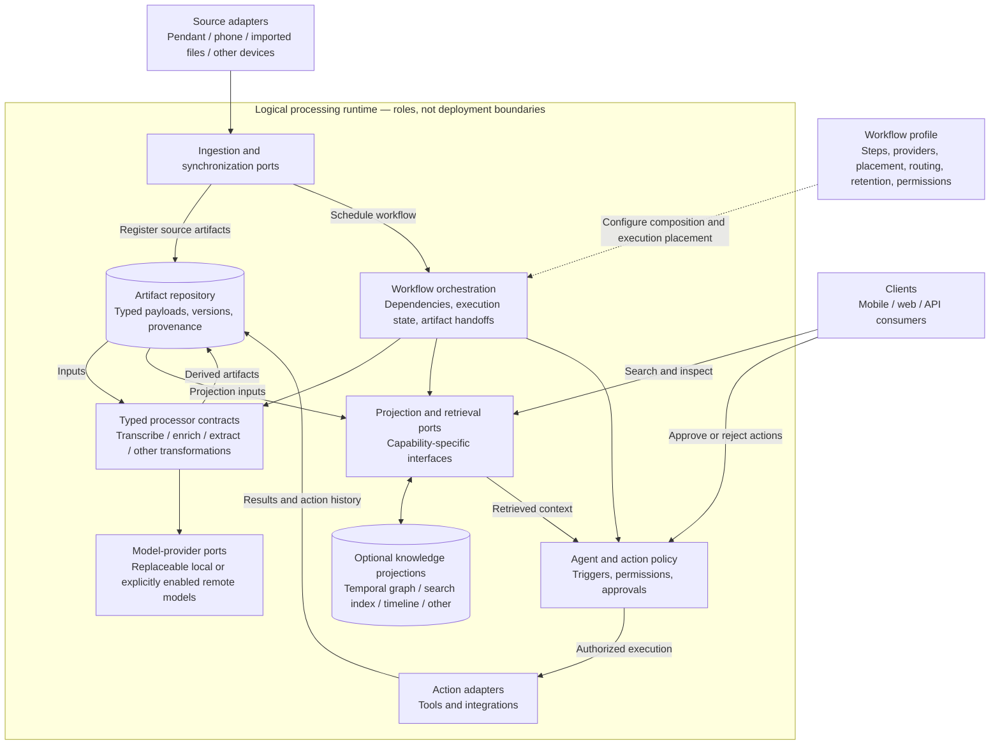
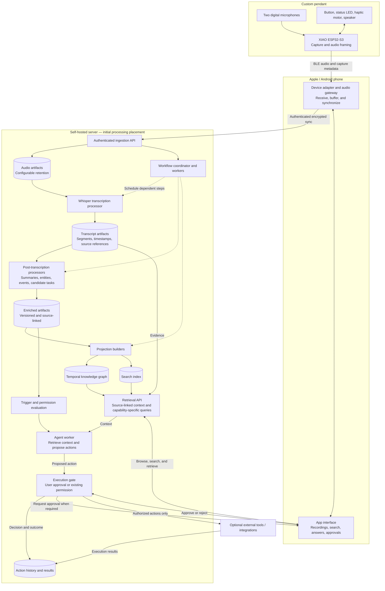

# YAP

YAP is an open-hardware, open-source personal voice recorder and self-hosted agentic processing stack, designed around privacy and user control. It aims to turn captured audio into searchable transcripts, contextual knowledge, and user-authorized actions without requiring a vendor-operated cloud.

**Status:** the diagrams below describe the intended architecture and initial reference configuration. They are design documentation, not a claim that these capabilities are implemented.

## 1. Highest-level architecture

YAP is an **artifact-centric processing system built with ports and adapters**. Sources produce typed artifacts; processors transform them; optional projections organize their contents; policies govern actions. A workflow profile selects implementations and connects these roles without making a particular device, model, database, or deployment location part of the core contract.

### Deployment is configurable

These are logical roles, not mandatory services or machines. The same contracts can support:

- **Phone-local:** capture, transcription, and selected processing run on the phone.
- **Phone relay + server:** the phone receives and buffers device audio, then routes it to a self-hosted server for processing.
- **Split processing:** the phone performs a step such as transcription and sends its transcript artifact to the server for enrichment, indexing, or agent execution.
- **Direct-to-server:** a capable capture device or file importer sends artifacts to the server without a phone relay.

Phone and server are not mutually exclusive choices. A workflow profile specifies **where each step executes and which artifacts cross each connection**. Moving a step must preserve artifact identity, schema, provenance, access controls, and synchronization semantics. Deployment capabilities constrain placement; not every device can run every processor.

Start with a modular application and workers, not mandatory microservices. Plugins can be ordinary modules implementing explicit interfaces; a distributed plugin platform is not required.

### Stable contracts, replaceable implementations

- **Artifacts:** typed payloads with an ID, schema version, parent/source references, creation time, applicable capture/event times, and producer/model/configuration versions. Keep source transcripts separate from derived interpretations.
- **Processors:** declared input/output artifact types and configuration schemas. A replacement must satisfy the same contract; a new kind of output gets a new schema rather than being hidden inside unstructured JSON.
- **Projections:** rebuildable representations of retained artifacts. A temporal knowledge graph is one option, not the authoritative store for all data. Retrieval exposes supported capabilities rather than pretending graph traversal and document search are identical.
- **Profiles:** declarative composition of registered components, execution placement, transfer routes, model choices, retention settings, and permissions. The initial profile below is a reference configuration, not a fixed pipeline.
- **Actions:** external side effects are separate from artifact transformations. An extracted task is not authorization to execute it. Approval and an action history remain explicit.

## 2. Initial reference configuration

The initial build is a **XIAO ESP32-S3 pendant with two microphones**, connected to an Apple or Android phone. The phone is both the user interface and an audio gateway to a self-hosted processing server. Whisper is the initial transcription choice; enrichment feeds a temporal knowledge graph and search projection. Agents propose actions by default, with execution gated by approval or a previously granted policy.

Solid arrows show data or interaction paths. Dashed arrows show scheduling/configuration rather than artifact transfer. Storage boxes represent logical datasets, not a requirement for a separate database per box.

### Initial boundaries and design constraints

- **No required vendor cloud:** the reference processing path is self-hosted. Any external model or integration must be explicitly enabled, with its data-sharing boundary visible to the user.
- **Transport is not permanent retention:** phone buffering, server ingestion, and retained audio have distinct lifecycles. Raw audio can expire independently of transcripts; deleting source audio limits what can later be retranscribed or verified.
- **Evidence before interpretation:** preserve the original transcript artifact and link summaries, facts, events, and actions back to source segments. Record corrections and processing versions without silently rewriting the evidence.
- **Temporal semantics:** distinguish when an event occurred or a fact was valid from when YAP learned or recorded it. Preserve conflicting claims and corrections with provenance.
- **Safe execution:** transcription and retrieved content are untrusted inputs, not instructions granting tool access. Approval decisions and execution outcomes are recorded separately; repeated synchronization must not create duplicate external actions.
- **Evolving hardware:** microphones, storage, driver circuits, battery, antenna placement, and enclosure details remain build-specific. The diagram does not imply that the ESP32-S3 firmware or a disconnected-recording storage path is already implemented.

## Repository layout

| Directory | Intended responsibility |
| --- | --- |
| `enclosure/cad/` | Editable enclosure CAD and mechanical references |
| `enclosure/stls/` | Printable enclosure exports |
| `apps/apple/` | Apple client and device-gateway implementation |
| `apps/android/` | Android client and device-gateway implementation |
| `server/` | Self-hosted runtime, APIs, workers, and deployment setup |
| `data-structures/` | Versioned artifact contracts, knowledge-model semantics, and projection definitions, independent of app UI and core capture behavior |
| `build/` | Physical pendant parts, wiring, and build configurations |

Only this README is populated as part of the architecture review. Model providers, graph/search technologies, API schemas, and firmware details will be selected and documented separately.
