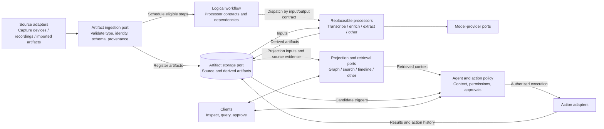
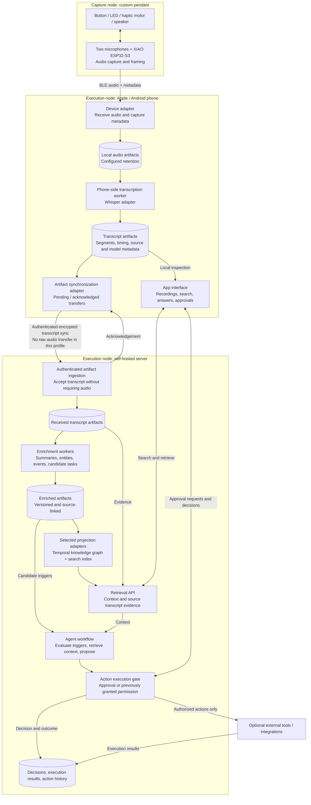

# YAP

YAP is an open-hardware, open-source personal voice recorder and self-hosted agentic processing stack, designed around privacy and user control. It aims to turn captured audio into searchable transcripts, contextual knowledge, and user-authorized actions without requiring a vendor-operated cloud.

**Status:** the diagrams below describe the intended architecture and initial reference configuration. They are design documentation, not a claim that these capabilities are implemented.

## 1. Logical architecture: artifacts and transformations

YAP is an **artifact-centric processing system built with ports and adapters**. Sources produce typed artifacts; processors transform them; optional projections organize their contents; policies govern actions. None of these roles inherently belongs to a phone, server, or capture device.

This is a **logical component/dataflow diagram**, not a deployment diagram. The artifact storage port can bind to node-local stores; it does not imply one central repository. A workflow can begin with audio, a transcript, or another supported artifact type. Receiving a transcript does not require uploading its source audio or rerunning transcription.

### Workflow, placement, and transport are separate

| Concern | Defines | Example |
| --- | --- | --- |
| **Workflow** | Transformations, typed inputs/outputs, and dependencies | Audio → transcript → enrichment → selected projections |
| **Placement** | Which capable execution node runs each step | Transcription on phone; enrichment on server |
| **Transport** | Which artifacts cross node boundaries and how | BLE audio to phone; authenticated encrypted transcript sync to server |

An **execution profile** binds workflow steps to processor/model implementations and execution nodes, and declares permitted transfer routes, retention, and action policies. It configures the workflow without changing processor contracts.

Execution nodes can be a phone, a self-hosted server, or capable capture hardware. A phone can host capture, transcription, enrichment, storage, retrieval, and agents—not just a gateway. Phone and server may cooperate, and neither is mandatory for every profile.

Example profiles:

- **Phone-local:** selected processing and storage stay on the phone.
- **Phone transcription + server enrichment:** only transcript artifacts and their required metadata synchronize to the server by default.
- **Phone relay + server transcription:** the phone sends audio to the server under a separately configured transfer policy.
- **Direct-to-server:** capable hardware or a file importer delivers artifacts without a phone relay.

Start with **explicit, static placement**, not an automatic distributed scheduler or live processor migration. Validate that each selected node can execute its assigned contracts. If a processor or destination is unavailable, retain pending work according to the configured policy and expose its state. Do not silently upload audio or switch providers as a fallback; any alternate route requires explicit configuration and permission.

Cross-node handoffs must preserve artifact identity, schema versions, capture/event timestamps, source references, and access controls. Synchronization must recognize repeated artifacts rather than treating every transfer as new input. Provenance may reference source audio that remains on another node or has expired; it does not grant access or guarantee availability.

Start with modular applications and workers, not mandatory microservices. Plugins can be ordinary modules implementing explicit interfaces.

### Stable contracts, replaceable implementations

- **Artifacts:** typed payloads with an ID, schema version, parent/source references, creation time, applicable capture/event times, and producer/model/configuration versions. Keep source transcripts separate from derived interpretations.
- **Processors:** declared input/output artifact types and configuration schemas. A replacement must satisfy the same contract; a new kind of output gets a new schema rather than being hidden inside unstructured JSON.
- **Projections:** rebuildable representations of retained artifacts. A temporal knowledge graph is one option, not the authoritative store for all data. Retrieval exposes supported capabilities rather than pretending graph traversal and document search are identical.
- **Profiles:** separate the logical workflow from its execution bindings and transfer policies. Rebinding a compatible processor to another node must not change its artifact contract or silently change the privacy boundary.
- **Actions:** external side effects are separate from artifact transformations. An extracted task is not authorization to execute it. Approval and an action history remain explicit.

## 2. Reference deployment: phone transcription, server enrichment

This concrete profile uses a **XIAO ESP32-S3 pendant with two microphones**, an Apple or Android phone, and a self-hosted server. **Whisper runs on the phone** as the initial transcription choice. The phone synchronizes transcript artifacts to the server, where post-transcription processors build the selected knowledge projections and agents propose permitted actions.

This is one planned deployment of the logical contracts above—not the only supported architectural arrangement. Phone-side model choice, performance, and power consumption still require implementation and device validation.

The node boxes show **execution placement for this profile**. Audio remains on the phone under its retention policy; the server begins at the transcript stage and does not retranscribe by default. Audio upload or server-side transcription requires an explicitly selected alternative profile or permitted route, not an implicit fallback.

The diagrams omit worker-management details for readability. Each executing node needs local workflow state and must preserve pending work and handoff status across interruptions according to its configured retention policy. Storage boxes are logical datasets, not a requirement for a separate database per box.

### Boundaries and design constraints

- **No required vendor cloud:** processing runs within user-controlled nodes. Any external model or integration must be explicitly enabled, with its data-sharing boundary visible to the user.
- **Transport is not permanent retention:** local audio retention, transcript synchronization, and server artifact retention have distinct lifecycles. Deleting source audio limits later retranscription or verification; artifact metadata must not imply that expired or remote audio is locally available.
- **Evidence before interpretation:** preserve the original transcript artifact and link summaries, facts, events, and actions back to source segments. Record corrections and processing versions without silently rewriting the evidence.
- **Temporal semantics:** distinguish when an event occurred or a fact was valid from when YAP learned or recorded it. Preserve conflicting claims and corrections with provenance.
- **Safe execution:** transcription and retrieved content are untrusted inputs, not instructions granting tool access. Approval decisions and execution outcomes are recorded separately; repeated synchronization must not create duplicate external actions.
- **Evolving hardware:** microphones, storage, driver circuits, battery, antenna placement, and enclosure details remain build-specific. The diagram does not imply that the ESP32-S3 firmware or a disconnected-recording storage path is already implemented.

## Repository layout

| Directory | Intended responsibility |
| --- | --- |
| `enclosure/cad/` | Editable enclosure CAD and mechanical references |
| `enclosure/stls/` | Printable enclosure exports |
| `apps/apple/` | Apple UI, device adapters, on-device processors, local storage, and artifact synchronization |
| `apps/android/` | Android UI, device adapters, on-device processors, local storage, and artifact synchronization |
| `server/` | Self-hosted runtime, APIs, workers, and deployment setup |
| `data-structures/` | Versioned artifact contracts, knowledge-model semantics, and projection definitions, independent of app UI and core capture behavior |
| `build/` | Physical pendant parts, wiring, and build configurations |

See [data structures and processing research](data-structures/research/README.md) for source-backed project comparisons, temporal knowledge modeling notes, and open design questions. These research recommendations are not finalized schemas or technology selections.
